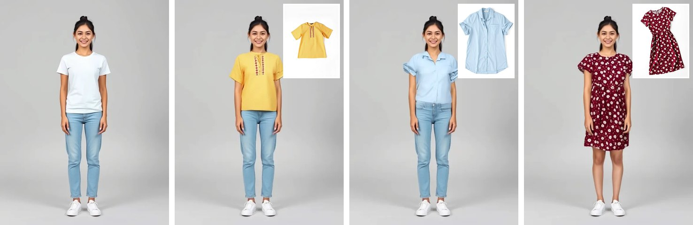
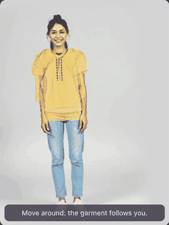
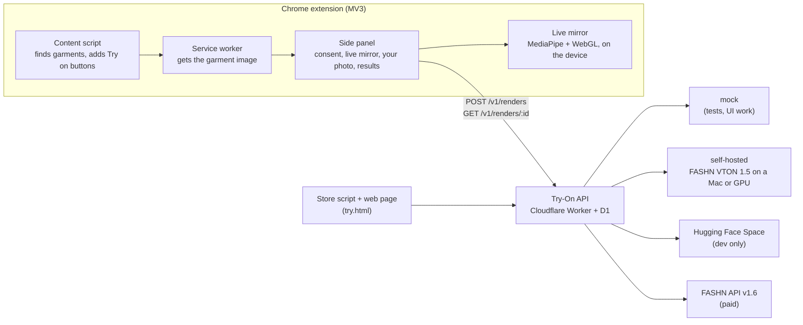
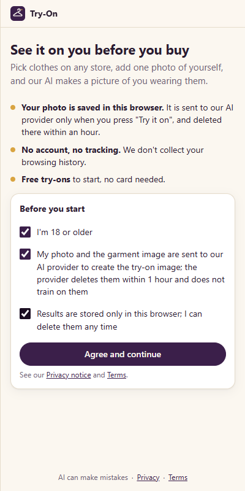

# Try-On

See clothes from any online store on you before you buy: live on your camera, or as an AI photo.

[](https://tryonlab.vercel.app)
[](#run-it)
[](tsconfig.base.json)
[](extension)
[](api)
[](LICENSE)



*Real output from FASHN VTON 1.5. Left: the photo. Then the same person wearing each garment, with the product photo the model was given in the corner. The model and garment photos are AI-generated (FLUX.1-schnell), so no real person's photo is used.*

## What it does

You're on a store page and you like a kurta. Click the Try-On icon and you get two ways to see it on you:

- **Live mirror.** Your camera opens in the side panel and the garment appears on you. It follows your shoulders, arms and hips as you move, your own shirt is taken off where the new one doesn't cover it, and the light and folds of your real body show on the new fabric. It runs on your computer. Nothing from the camera leaves it.
- **AI photo.** Press "Make it real" (or "Try it on" with a saved photo) and an AI model draws you wearing the garment. On a MacBook Pro M1 Pro that takes about two minutes, free, on the Mac itself.

Your photo and results stay in your browser.

Why two modes: a live AI video of you in new clothes, the way Anywear does it with Decart's model, costs about $1.20 a minute at list price and needs data-center GPUs. One AI photo costs $0.04-0.075 with a hosted API, or nothing on your own computer. So the live view is built on the device from the product photo, and the AI is used for the still photo.

Three pieces share one API: the **Chrome extension** for shoppers, a **store script** for brands that adds a "Try it on" button to their own product pages, and the **Try-On API**, a Cloudflare Worker with swappable AI providers.

## Try the demo

**[tryonlab.vercel.app](https://tryonlab.vercel.app)** runs the extension's side panel in a normal web page, next to a sample store.


Use the sample model with any of the three garments and the panel returns the real render above. The hosted demo is the October build: it doesn't have the live mirror yet, because that needs the extension (or the new web page) and a camera.

A recording of the live mirror and an AI render made on the Mac, in the extension, is in [docs/media/try-on-demo.mp4](docs/media/try-on-demo.mp4). The person in it is the AI-generated sample model, fed to Chrome as a fake webcam.

## The live mirror



Every camera frame, on the device:

1. MediaPipe's pose model finds shoulders, elbows, wrists, hips, knees and ankles, and its segmenter labels skin, hair, clothes and background.
2. The garment was cut out of its product photo once when you picked it: with the clothes segmenter when a model wears it (a regular top stops near the hips, so same-colour shorts don't come along; kurtas and tunics keep their length), or by removing the plain background when it's laid flat.
3. The cut-out is a mesh skinned to the body. Each point of it is tied to the torso and the nearest limb bones, so sleeves bend with your elbows and wrists and a skirt follows your legs.
4. WebGL draws the frame. Your own clothes that the new garment replaces (picked out by colour, so a new top doesn't take your jeans) become skin on your body and the room behind loose fabric. Small gaps are covered by the garment's edge. Your hands stay in front of the garment when they're across your body.

"Make it real" saves the current frame as your photo and starts the AI try-on from it.

It is still a moving cut-out of the product photo, so it shows the garment from the front only, without cloth physics. See [Limitations](#limitations).

## AI photos on your own Mac

`vton-server/` runs the open FASHN VTON 1.5 model (Apache-2.0) behind a small JSON API, and the API's `self-hosted` provider sends renders to it. It runs on Apple Silicon with PyTorch's Metal backend after two fixes: the model builds its position encodings in float64, which Metal doesn't support, and its attention builds full 6,912 by 6,912 matrices, which made a 32 GB Mac swap, so attention runs in chunks.

Measured on a MacBook Pro M1 Pro, 32 GB, for one render of the sample model:

| Settings | Time |
|---|---|
| float16, 10 steps, guidance 1.0 (the default) | 93-103 s |
| float16, 10 steps, guidance 1.5 | 167 s |
| In the extension, from "Try it on" to the result, on six live stores | 118-132 s |

Guidance 1.0 skips the model's second pass, which halves the time. On the sample garments it looked as good. Before rendering, the server checks the photo shows one person and enough of the body for the garment (hips for tops, knees for dresses), and answers with a clear message if not.

## How it works



| Step | What happens |
|---|---|
| 1 | You click the toolbar icon or right-click an image ("Try this on"). That grants `activeTab` for this tab only. No `<all_urls>`. |
| 2 | The detector reads JSON-LD, `og:image`, `srcset`, lazy-load attributes and shadow roots (closed ones too, through `chrome.dom`) to find the product image, its title and its category (desi-aware, so a kurta or a 3-piece suit maps correctly). |
| 3 | The service worker fetches the image. If the store's CDN blocks that, it crops a screenshot of the visible image, then offers a one-site permission, then upload. |
| 4 | The live mirror or the AI photo. For the photo, the side panel sends your photo and the garment to the API with an idempotency key, then polls until the render is done, showing the queue place and progress. |
| 5 | The API checks the install token, quota, per-IP limit and a daily spend breaker, then calls the provider. Images are never stored; the ledger keeps ids, status, cost and timings, and a nightly job deletes old rows. |
| 6 | The result is saved in IndexedDB in your browser. "Delete all my data" removes everything there and on the server. |

## Features

- Live mirror on your camera, on the device, from any product photo: skinned to your joints, your own clothes taken off, real light and folds, hands in front.
- On-demand "Try on" buttons on product images (in a closed Shadow DOM), a right-click menu, and drag-and-drop into the panel.
- A garment image ladder that works on stores whose CDN blocks cross-origin reads, without asking for broad permissions.
- Free AI renders on your own Mac (`vton-server`), with a one-person and body check before each render.
- A store script: one `<script>` tag adds "Try it on" to a brand's product page and opens the try-on in a modal. The store never sees the shopper's photo, only event names for its analytics.
- A web try page (`try.html`) with the same fitting room, for people without the extension.
- Optional "Sign in with Google" for more free try-ons each month. Only a keyed hash of the Google account id is kept, no email or name.
- Privacy notice and terms, a 90-day retention schedule run nightly, and server-side deletion from "Delete all my data".
- Consent screen and 18+ check before any photo. Camera capture with a countdown, or upload.
- API with HMAC install tokens, 3 free renders per install, a per-IP daily limit (the IP is stored only as an HMAC hash), a $5/day spend breaker per provider, and refunds when a provider fails.
- 279 TypeScript tests across the four packages and 29 Python tests for the render server. Also a CORS matrix tool, a blind-rating eval harness, and an end-to-end script that drives real Chrome on live stores.

| The fitting room, before you start | A finished render, with feedback and download |
|---|---|
|  |  |

## Tested on real stores

`tools/chrome-e2e.mjs` loads the extension into a separate Chrome profile, opens live product pages, clicks the extension's own "Try on" button and runs the side panel to a finished AI render from the Mac, with the AI sample model as the photo. Results from 25 November 2026:

| Store | Country | Garment | AI render on the Mac |
|---|---|---|---|
| Outfitters | Pakistan | Crew neck long-sleeve T-shirt | 132 s |
| Khaadi | Pakistan | Embroidered long-sleeve kurta | 131 s |
| Sapphire | Pakistan | Modest wear top | 124 s |
| Limelight | Pakistan | Sleek collar top | 123 s |
| Gymshark | UK | Training T-shirt | 124 s |
| Pangaia | UK | Men's midweight T-shirt | 118 s |
| Uniqlo | US | Mini T-shirt | 123 s |

The first pass missed five of these: the panel only added its buttons after a page reported it had fully loaded, and heavy store pages do that late. The panel now also adds them shortly after a page starts loading, and the second pass got all seven. Uniqlo's image server doesn't allow cross-origin reads, so in normal use the extension takes a screenshot of the photo or offers the one-site permission; in this test the image came through the test copy's host access.

DevTools can't click Chrome's toolbar button, which is what normally grants the extension access to a page, so the test copy of the extension gets host access instead. Everything after that is the extension's normal code. The CORS matrix ([docs/cors-matrix.md](docs/cors-matrix.md)) checks the same stores from a plain script: most of them now answer scripts with a bot check, which says nothing about a real browser.

## Tech stack

| Part | Built with |
|---|---|
| Extension | TypeScript, no UI framework, esbuild, Chrome MV3 (`sidePanel`, `activeTab`, `scripting`, `contextMenus`), IndexedDB |
| Live mirror | MediaPipe Tasks Vision (pose landmarker, selfie multiclass segmenter), WebGL 2 |
| API | Cloudflare Workers, D1 (SQLite), Wrangler |
| AI providers | FASHN VTON 1.5 self-hosted (PyTorch, Metal or CUDA), FASHN API v1.6, a Hugging Face Space, mock |
| Tests | Vitest, happy-dom, Python unittest |

## Run it

Needs Node 24 or newer and Chrome 116 or newer. The render server needs Python 3.12 and, for useful speed, Apple Silicon or an NVIDIA GPU.

```bash
git clone https://github.com/shakaibarsalan/tryon
cd tryon
npm install                          # .npmrc turns install scripts off and pins exact versions
npm test                             # 279 tests across the four packages
npm run fetch-models -w extension    # the two MediaPipe models for the live mirror (22 MB, checksummed)
npm run build -w extension           # dev build into extension/dist
```

**Free AI renders on a Mac.** Install PyTorch and FASHN VTON 1.5 in a virtual environment, download the weights (about 2 GB), and start the server. See [vton-server/README.md](vton-server/README.md) for the exact steps.

```bash
python vton-server/server.py --port 7861 --dtype float16 --steps 10 --guidance 1.0
```

**The API, using that server:**

```bash
cd api
npm run migrate:local
npx wrangler dev --port 8787 --var PROVIDER:self-hosted
```

Then open `chrome://extensions`, turn on Developer mode, click **Load unpacked** and pick `extension/dist`. Pin the icon and click it on any store page. The first time you open the live mirror it opens in a tab so Chrome can ask for the camera; after that it works in the side panel.

Other providers: `PROVIDER=mock` (no AI, for UI work), `PROVIDER=hf-space` (the free Hugging Face Space, a few renders a day, needs `HF_TOKEN`), `PROVIDER=fashn` (paid, needs `FASHN_API_KEY`).

`npm run serve -w extension` serves `extension/dist` on http://localhost:5178: the old demo at `/dev/demo.html`, the web try page at `/try.html` and a sample product page with the store script at `/dev/store.html`. `npm run package -w extension` builds the Chrome Web Store zip into `extension/release/`.

## Configuration

Secrets go in `api/.dev.vars` locally (git-ignored) and in `wrangler secret put` for production:

| Name | Example | What it's for |
|---|---|---|
| `INSTALL_TOKEN_SECRET` | 32 random bytes, base64url | Signs install and account tokens, keys the IP hash. Required in production |
| `VTON_SERVER_TOKEN` | random string | Bearer token for `vton-server`. Required for `self-hosted` in production |
| `FASHN_API_KEY` | `your-fashn-key` | Only for `PROVIDER=fashn` |
| `HF_TOKEN` | `hf_...` | Optional, more free quota for `PROVIDER=hf-space` |

Plain settings live in `api/wrangler.toml`: `PROVIDER` (`mock`, `self-hosted`, `hf-space`, `fashn`), `VTON_SERVER_URL`, `GOOGLE_CLIENT_ID` (turns sign-in on), `ACCOUNT_RENDERS_PER_MONTH` (5), `DAILY_BUDGET_USD` (5), `FREE_RENDERS_PER_INSTALL` (3), `IP_DAILY_LIMIT` (20) and `ALLOWED_ORIGINS`. The extension reads its API and web addresses at build time: `TRYON_API=https://api.example.com TRYON_WEB=https://web.example.com npm run build:release -w extension`.

## Project structure

```
packages/shared/     Contracts every part shares: types, limits, category mapping
packages/detector/   Finds garment images, titles and categories on store pages
api/                 Try-On API (Cloudflare Worker, D1) and its providers
extension/           Chrome MV3 extension, live mirror, web try page, store script
vton-server/         FASHN VTON 1.5 render server (Python) for the self-hosted provider
eval/                Blind rating harness for comparing providers on a golden set
tools/               CORS matrix, end-to-end Chrome run, fake camera, demo clip, sample renders
docs/                Privacy notice and terms, CORS results, provider research, images
```

## Limitations

- The live mirror is a moving cut-out of the product photo, not an AI video. It shows the garment from the front, it doesn't drape or swing like cloth, and turning side-on doesn't turn the garment. Edges can show a thin seam, and where your own clothes are much bigger than the new garment they become skin.
- A photoreal live try-on like Anywear's needs a video model on data-center GPUs. This project has no budget for that, so the realistic picture is the AI photo.
- An AI photo takes about two minutes on an M1 Pro. A CUDA GPU or the paid FASHN API is much faster.
- Long kurtas: in October a knee-length, long-sleeve kurta came back with short, puffed sleeves through the Hugging Face Space. On the Mac, Khaadi's long-sleeve kurta kept its sleeves and embroidery, but as a "Top" it ends at mid-thigh. Picked as "Dress or full outfit", the model wears the whole suit, trousers included, which suits 2- and 3-piece sets.
- FASHN VTON 1.5 is Apache-2.0, but its human parser uses NVIDIA's non-commercial SegFormer licence, so the self-hosted provider is for personal and non-commercial use until the parser is swapped.
- Sign-in is built and tested, but it needs a Google OAuth client id (free) to switch on.
- The API isn't deployed, and the hosted demo is the October build. The Chrome Web Store zip is ready but not submitted.
- With the MediaPipe models the extension is about 37 MB.
- Images inside cross-origin iframes aren't detected, and the screenshot fallback only works while the image is on screen.

## License

MIT. See [LICENSE](LICENSE). AI models and provider APIs have their own terms; the FASHN VTON 1.5 Space is for development use, and MediaPipe's models are Apache-2.0.

## Author

Shakaib Arsalan · [shakaib.vercel.app](https://shakaib.vercel.app) · [LinkedIn](https://www.linkedin.com/in/shakaib-arsalan)
