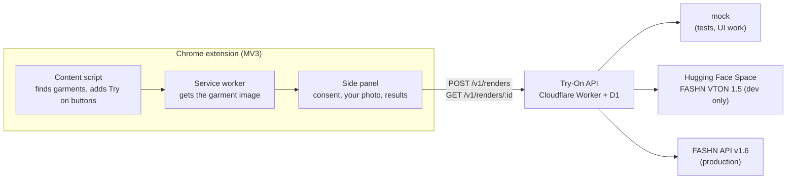
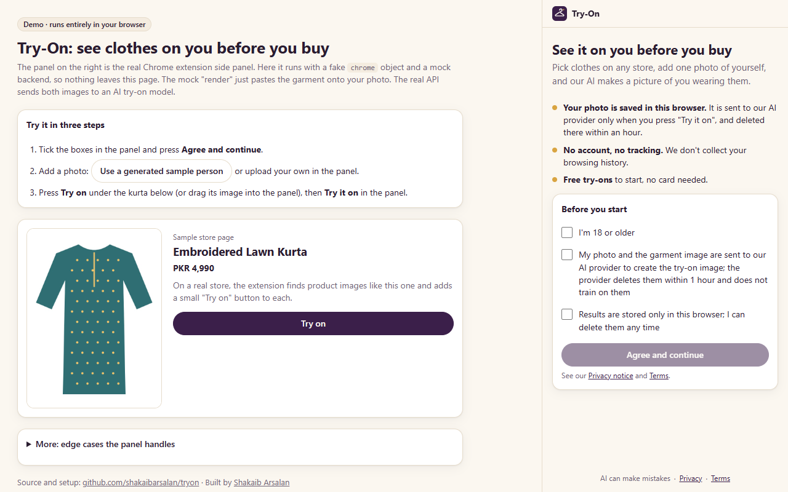
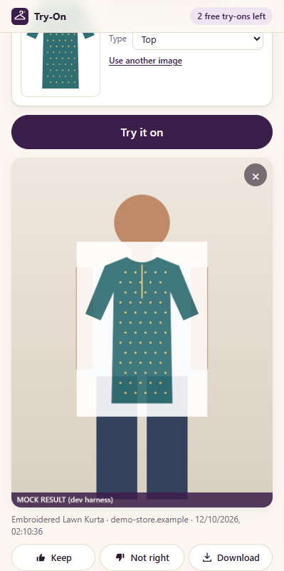

# Try-On

See clothes from any online store on your own photo, before you buy.


**Live demo: [tryonlab.vercel.app](https://tryonlab.vercel.app)**. It is the real extension side panel running in a normal web page, with a fake `chrome` object and a mock backend. Nothing leaves your browser, and the mock "render" just pastes the garment onto your photo. Real renders go through an AI try-on model, which needs an API key or a GPU.

## What it does

You're on a store page and you like a kurta. Click the Try-On icon, add one photo of yourself, pick the garment, and get a picture of you wearing it. Your photo and results stay in your browser.

It's photo-first on purpose. Live webcam try-on (streaming video to a model) costs about $1.20 a minute at list price. A single AI photo costs $0.04-0.075 with a hosted API, or around $0.01-0.02 on a self-hosted open model. So the product is built around photos.

Three pieces share one API: a **Chrome extension** for shoppers (built), a **store widget** for brands (designed, not built yet), and the **Try-On API**, a Cloudflare Worker with swappable AI providers (built).

## How it works



| Step | What happens |
|---|---|
| 1 | You click the toolbar icon or right-click an image ("Try this on"). That grants `activeTab` for this tab only. No `<all_urls>`. |
| 2 | The detector reads JSON-LD, `og:image`, `srcset`, lazy-load attributes and open shadow roots to find the product image, its title and its category (desi-aware, so a kurta or a 3-piece suit maps correctly). |
| 3 | The service worker fetches the image. If the store's CDN blocks that, it crops a screenshot of the visible image, then offers a one-site permission, then upload. |
| 4 | The side panel sends your photo and the garment to the API with an idempotency key, then polls until the render is done. |
| 5 | The API checks the install token, quota, per-IP limit and a daily spend breaker, then calls the provider. Images are never stored; the ledger keeps ids, status, cost and timings. |
| 6 | The result is saved in IndexedDB in your browser. "Delete all my data" removes everything. |

## Features

- On-demand "Try on" buttons on product images (in a closed Shadow DOM), a right-click menu, and drag-and-drop.
- A garment image ladder that works on stores whose CDN blocks cross-origin reads, without asking for broad permissions.
- Consent screen and 18+ check before any photo. Camera capture with a countdown, or upload.
- Results kept on the device, with download and "Keep / Not right" feedback.
- API with HMAC install tokens, 3 free renders per install, a per-IP daily limit (the IP is stored only as an HMAC hash), a $5/day spend breaker per provider, and refunds when a provider fails.
- Providers behind one interface: `mock`, `hf-space` (the free FASHN VTON 1.5 Space, dev only) and `fashn` (FASHN API).
- 212 unit tests across the four packages, a CORS matrix tool that checks which stores' images can be fetched directly, and a blind-rating eval harness for comparing providers.

| The fitting room, before you start | A finished (mock) render |
|---|---|
|  |  |

## Tech stack

| Part | Built with |
|---|---|
| Extension | TypeScript, no UI framework, esbuild, Chrome MV3 (`sidePanel`, `activeTab`, `scripting`, `contextMenus`), IndexedDB |
| API | Cloudflare Workers, D1 (SQLite), Wrangler |
| AI providers | FASHN API v1.6, FASHN VTON 1.5 on a Hugging Face Space (Gradio), mock |
| Tests | Vitest, happy-dom |

## Run it

Needs Node 24 and Chrome 116 or newer.

```bash
git clone https://github.com/shakaibarsalan/tryon
cd tryon
npm install                    # .npmrc turns install scripts off and pins exact versions
npm test                       # all four packages
npm run build -w extension     # dev build into extension/dist, including the demo page
npm run serve -w extension     # http://localhost:5178/dev/demo.html, same as the live demo
```

**The real extension, with the mock provider:**

```bash
cd api
npm run migrate:local          # local D1 database
npm run dev                    # Try-On API on http://localhost:8787
```

Then open `chrome://extensions`, turn on Developer mode, click **Load unpacked** and pick `extension/dist`. Pin the icon and click it on any store page.

**Real AI renders (free, a few a day):** copy `api/.dev.vars.example` to `api/.dev.vars`, add a free Hugging Face read token as `HF_TOKEN`, and start the API with the Space provider:

```bash
cd api
npx wrangler dev --port 8787 --var PROVIDER:hf-space
```

A render through the API and the free Space took about 27 seconds when I tested it. For production, set `PROVIDER=fashn` and a `FASHN_API_KEY`.

## Configuration

Secrets go in `api/.dev.vars` locally (git-ignored) and in `wrangler secret put` for production:

| Name | Example | What it's for |
|---|---|---|
| `INSTALL_TOKEN_SECRET` | 32 random bytes, base64url | Signs install tokens and keys the IP hash. Required in production |
| `FASHN_API_KEY` | `your-fashn-key` | Only for `PROVIDER=fashn` |
| `HF_TOKEN` | `hf_...` | Optional, more free quota for `PROVIDER=hf-space` |

Plain settings live in `api/wrangler.toml`: `PROVIDER` (`mock`, `hf-space`, `fashn`), `DAILY_BUDGET_USD` (5), `FREE_RENDERS_PER_INSTALL` (3), `IP_DAILY_LIMIT` (20) and `ALLOWED_ORIGINS`. The extension reads its API address at build time: `TRYON_API=https://api.example.com npm run build:release -w extension`.

## Project structure

```
packages/shared/     Contracts every part shares: types, limits, category mapping
packages/detector/   Finds garment images, titles and categories on store pages
api/                 Try-On API (Cloudflare Worker, D1) and its providers
extension/           Chrome MV3 extension; dev/ holds the harness and the demo page
eval/                Blind rating harness for comparing providers on a golden set
tools/               cors-matrix.mjs: can the extension fetch each store's images?
docs/                Plan, engineering design, CORS results, provider research
```

Each folder has its own README with the details.

## Limitations

- Paused at Phase 0. The extension and API work end to end locally; nothing is deployed except the static demo.
- The store widget and the web app are designed but not built.
- There's no person-photo check yet (one person, torso visible). A head-and-shoulders photo only shows the neckline of a dress.
- The free Hugging Face Space allows a few renders a day. Real use needs a FASHN key, or a GPU with about 8 GB of VRAM to self-host FASHN VTON 1.5.
- Images inside iframes and closed shadow roots aren't detected, and the screenshot fallback only works while the image is on screen.
- No sign-in yet: free renders are counted per install. The Privacy and Terms links are placeholders.
- The demo is mock-only. It shows the real panel and flow, not real AI output.

## License

MIT. See [LICENSE](LICENSE). AI models and provider APIs have their own terms.

## Author

Shakaib Arsalan · [shakaib.vercel.app](https://shakaib.vercel.app) · [LinkedIn](https://www.linkedin.com/in/shakaib-arsalan)
