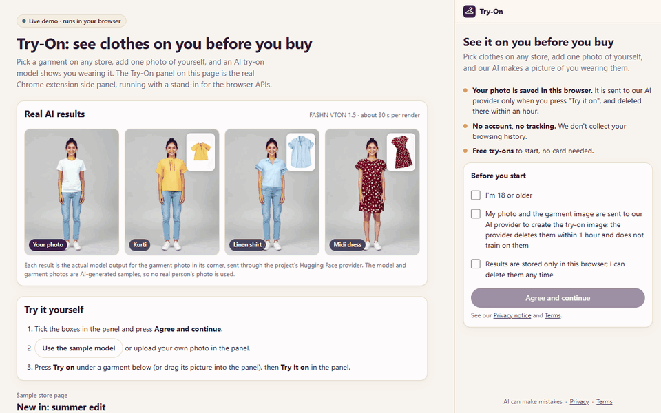
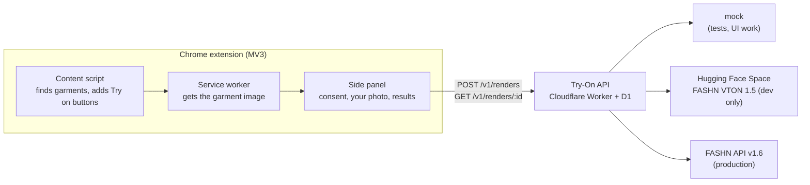
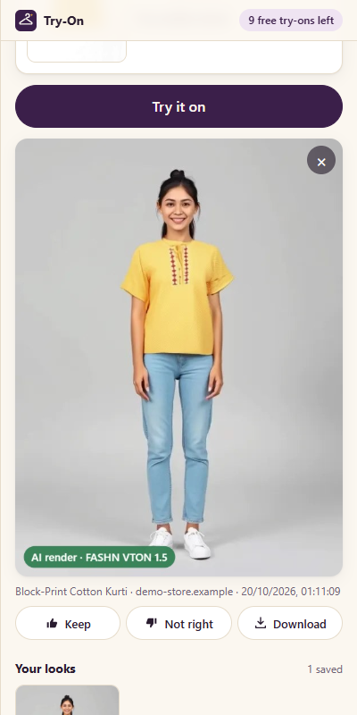

# Try-On

See clothes from any online store on your own photo, before you buy.

[](https://tryonlab.vercel.app)
[](#run-it)
[](tsconfig.base.json)
[](extension)
[](api)
[](LICENSE)


*Real output from FASHN VTON 1.5. Left: the photo. Then the same person wearing each garment, with the product photo the model was given in the corner. The model and garment photos are AI-generated (FLUX.1-schnell), so no real person's photo is used.*

## Try the demo

**[tryonlab.vercel.app](https://tryonlab.vercel.app)** runs the real extension side panel in a normal web page, next to a sample store.



Use the sample model with any of the three garments and the panel returns the real render above. Your own photo works too, but in the demo it gets a quick preview that is clearly labelled as not AI. Live renders need the extension and the Try-On API with a FASHN key or a GPU, which a free static page can't offer. Everything else (consent, photo storage, garment picking, polling, errors, history) is the production code.

## What it does

You're on a store page and you like a kurta. Click the Try-On icon, add one photo of yourself, pick the garment, and get a picture of you wearing it. Your photo and results stay in your browser.

It's photo-first on purpose. Live webcam try-on (streaming video to a model) costs about $1.20 a minute at list price. A single AI photo costs $0.04-0.075 with a hosted API, or around $0.01-0.02 on a self-hosted open model. So the product is built around photos.

Three pieces share one API: a **Chrome extension** for shoppers (built), a **store widget** for brands (designed, not built yet), and the **Try-On API**, a Cloudflare Worker with swappable AI providers (built).

## How it works



| Step | What happens |
|---|---|
| 1 | You click the toolbar icon or right-click an image ("Try this on"). That grants `activeTab` for this tab only. No `<all_urls>`. |
| 2 | The detector reads JSON-LD, `og:image`, `srcset`, lazy-load attributes and open shadow roots to find the product image, its title and its category (desi-aware, so a kurta or a 3-piece suit maps correctly). |
| 3 | The service worker fetches the image. If the store's CDN blocks that, it crops a screenshot of the visible image, then offers a one-site permission, then upload. |
| 4 | The side panel sends your photo and the garment to the API with an idempotency key, then polls until the render is done. |
| 5 | The API checks the install token, quota, per-IP limit and a daily spend breaker, then calls the provider. Images are never stored; the ledger keeps ids, status, cost and timings. |
| 6 | The result is saved in IndexedDB in your browser. "Delete all my data" removes everything. |

## Features

- On-demand "Try on" buttons on product images (in a closed Shadow DOM), a right-click menu, and drag-and-drop.
- A garment image ladder that works on stores whose CDN blocks cross-origin reads, without asking for broad permissions.
- Consent screen and 18+ check before any photo. Camera capture with a countdown, or upload.
- Results kept on the device, with download and "Keep / Not right" feedback.
- API with HMAC install tokens, 3 free renders per install, a per-IP daily limit (the IP is stored only as an HMAC hash), a $5/day spend breaker per provider, and refunds when a provider fails.
- Providers behind one interface: `mock`, `hf-space` (the free FASHN VTON 1.5 Space, dev only) and `fashn` (FASHN API).
- 212 unit tests across the four packages, a CORS matrix tool that checks which stores' images can be fetched directly, and a blind-rating eval harness for comparing providers.

| The fitting room, before you start | A finished render, with feedback and download |
|---|---|
|  |  |

## Tech stack

| Part | Built with |
|---|---|
| Extension | TypeScript, no UI framework, esbuild, Chrome MV3 (`sidePanel`, `activeTab`, `scripting`, `contextMenus`), IndexedDB |
| API | Cloudflare Workers, D1 (SQLite), Wrangler |
| AI providers | FASHN API v1.6, FASHN VTON 1.5 on a Hugging Face Space (Gradio), mock |
| Tests | Vitest, happy-dom |

## Run it

Needs Node 24 and Chrome 116 or newer.

```bash
git clone https://github.com/shakaibarsalan/tryon
cd tryon
npm install                    # .npmrc turns install scripts off and pins exact versions
npm test                       # 212 tests across the four packages
npm run build -w extension     # dev build into extension/dist, including the demo page
npm run serve -w extension     # http://localhost:5178/dev/demo.html, same as the live demo
```

**The real extension, with the mock provider:**

```bash
cd api
npm run migrate:local          # local D1 database
npm run dev                    # Try-On API on http://localhost:8787
```

Then open `chrome://extensions`, turn on Developer mode, click **Load unpacked** and pick `extension/dist`. Pin the icon and click it on any store page.

**Real AI renders (free, a few a day):** copy `api/.dev.vars.example` to `api/.dev.vars`, add a free Hugging Face read token as `HF_TOKEN`, and start the API with the Space provider:

```bash
cd api
npx wrangler dev --port 8787 --var PROVIDER:hf-space
```

A render through the free Space takes about 30 seconds. For production, set `PROVIDER=fashn` and a `FASHN_API_KEY`. To re-create the demo's sample renders, run `node tools/sample-renders.mjs`.

## Configuration

Secrets go in `api/.dev.vars` locally (git-ignored) and in `wrangler secret put` for production:

| Name | Example | What it's for |
|---|---|---|
| `INSTALL_TOKEN_SECRET` | 32 random bytes, base64url | Signs install tokens and keys the IP hash. Required in production |
| `FASHN_API_KEY` | `your-fashn-key` | Only for `PROVIDER=fashn` |
| `HF_TOKEN` | `hf_...` | Optional, more free quota for `PROVIDER=hf-space` |

Plain settings live in `api/wrangler.toml`: `PROVIDER` (`mock`, `hf-space`, `fashn`), `DAILY_BUDGET_USD` (5), `FREE_RENDERS_PER_INSTALL` (3), `IP_DAILY_LIMIT` (20) and `ALLOWED_ORIGINS`. The extension reads its API address at build time: `TRYON_API=https://api.example.com npm run build:release -w extension`.

## Project structure

```
packages/shared/     Contracts every part shares: types, limits, category mapping
packages/detector/   Finds garment images, titles and categories on store pages
api/                 Try-On API (Cloudflare Worker, D1) and its providers
extension/           Chrome MV3 extension; dev/ holds the harness, the demo page and its sample images
eval/                Blind rating harness for comparing providers on a golden set
tools/               cors-matrix.mjs (which stores' images can be fetched), sample-renders.mjs
docs/                CORS results, provider research, README images
```

Each folder has its own README with the details.

## Limitations

- The extension and API work end to end locally; only the static demo is deployed.
- The store widget and the web app are designed but not built.
- There's no person-photo check yet (one person, torso visible). A head-and-shoulders photo only shows the neckline of a dress.
- The model handles some garments better than others. Short and mid-length tops and dresses come out well; a knee-length kurta with long sleeves came back with short, puffed sleeves in my tests.
- The free Hugging Face Space allows a few renders a day. Real use needs a FASHN key, or a GPU with about 8 GB of VRAM to self-host FASHN VTON 1.5.
- Images inside iframes and closed shadow roots aren't detected, and the screenshot fallback only works while the image is on screen.
- No sign-in yet: free renders are counted per install. The Privacy and Terms links are placeholders.

## License

MIT. See [LICENSE](LICENSE). AI models and provider APIs have their own terms; the FASHN VTON 1.5 Space is for development use.

## Author

Shakaib Arsalan · [shakaib.vercel.app](https://shakaib.vercel.app) · [LinkedIn](https://www.linkedin.com/in/shakaib-arsalan)
