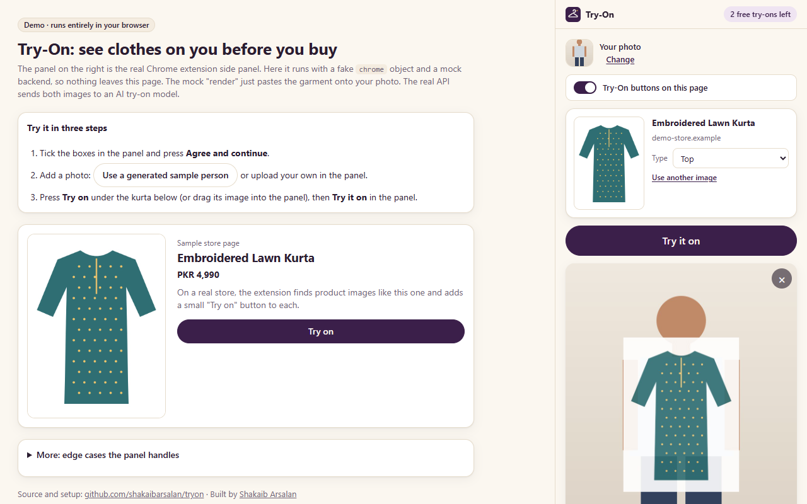

# Try-On: Chrome extension (Manifest V3)

Pick clothes on any store, add one photo of yourself, and get an AI picture of you wearing them.
Vanilla TypeScript + CSS, bundled with esbuild. No UI framework, no remote code.

## Build

From the repo root:

```bash
npm run build -w extension            # dev build -> extension/dist (sourcemaps + dev harness)
npm run build:release -w extension    # minified, no sourcemaps, no dist/dev
npm run watch -w extension            # rebuild on source changes
npm test -w extension                 # vitest unit tests
npx tsc -p extension/tsconfig.json    # typecheck
```

`TRYON_API` sets the Try-On API base URL at build time (default `http://localhost:8787`). Its
origin is the only entry in `host_permissions`. Example for a deployed API:

```bash
TRYON_API=https://api.example.com npm run build:release -w extension
```

The product name lives in one place, `src/brand.json`; the manifest, page titles and UI read it.
Icons (16/32/48/128) are drawn by `scripts/png.mjs` at build time (no image files in the repo).

## Load it in Chrome

1. Start the API locally: `npm run dev -w api` (listens on http://localhost:8787).
2. Build: `npm run build -w extension`.
3. Open `chrome://extensions`, turn on **Developer mode**, click **Load unpacked**, pick `extension/dist`.
4. Pin the extension and click its toolbar icon on a store page. Chrome 116 or newer is required.

After a rebuild, press the reload icon on the extension card. Pages that already had the content
script need a reload too (an orphaned copy removes its chips when clicked).

## How it works

| Piece | File | Role |
|---|---|---|
| Service worker | `src/background.ts` | Context menu, panel behaviour, garment byte pipeline, current garment in `storage.session` |
| Content script | `src/content.ts` | Injected on demand. "Try on" chips in a closed Shadow DOM; answers page-context questions |
| Side panel | `static/sidepanel.html`, `src/sidepanel.ts`, `static/css/panel.css` | Consent, your photo, fitting room, results |
| Camera tab | `static/camera.html`, `src/camera.ts` | First camera grant in a visible tab |
| Shared helpers | `src/lib/*` | API client, image encoding, IndexedDB, storage, geometry, drop parsing |

### Entry points

1. **Right-click an image, "Try this on".** The worker calls `chrome.sidePanel.open({tabId})` first,
   synchronously (the user gesture is gone after any `await`). It then injects the content script
   (allowed by the `activeTab` grant from the menu click) to describe the image with the detector
   (title, category, full-resolution URL, on-screen rect) and loads the garment bytes.
2. **Toolbar icon.** Opens the side panel (`openPanelOnActionClick`). The panel injects the content
   script into the active tab and turns on "Try on" chips when the toggle is on (default). Clicking
   a chip sends `GARMENT_PICKED` to the worker. A content-script message carries no user gesture,
   so a chip can never open the panel: if the panel is closed, the chip shows a small card saying
   "Open the fitting room from the toolbar" and the pick is kept for when the panel opens.
3. **Drag an image** from the page into the panel (`text/html` `` first, then `text/uri-list`,
   then files). URLs go through the worker's byte pipeline; files are read directly.
4. **Upload** a garment image from disk.

### Garment bytes (service worker)

1. `fetch(url)` from the worker for the detector's `imageUrl`, then the clicked URL and the other
   `altUrls` in order (up to 4). Works for Shopify CDNs (`Access-Control-Allow-Origin: *`) and for
   images on the tab's own origin (covered by `activeTab`).
2. If all fail: `chrome.tabs.captureVisibleTab` and crop the element's rect x devicePixelRatio
   (chips are hidden during the capture and the rect is measured again). The panel then offers
   "Sharper image: allow cdn.x.com".
3. If that fails too: `GARMENT_BYTES_FAILED` with `needsHostPermission` (the image origin). The panel
   shows "Allow images from cdn.x.com", which calls `chrome.permissions.request` inside the click
   handler, then asks the worker to retry.

Every source (AVIF, GIF, PNG with transparency, ...) is decoded with `createImageBitmap` and
re-encoded as JPEG on a white background, longest side `LIMITS.garmentMaxSide`, under
`LIMITS.maxImageBytes`. The current garment is kept in `chrome.storage.session`, so a panel opened
later picks it up.

### Your photo

The side panel can't show the camera permission prompt. "Take a photo" checks
`navigator.permissions`: if the camera is already granted it opens inline in the panel; otherwise it
opens `camera.html` in a normal tab, which asks once, shows a mirrored preview with a 3-second
countdown, crops to 3:4 portrait, and saves the photo (JPEG, longest side `LIMITS.personMaxSide`)
to IndexedDB. After that first grant the panel uses the camera directly (same extension origin).
Checks: at least 512 px tall; a warning for landscape photos. Upload is allowed in this preview
build only.

### Fitting room and renders

`POST /v1/installs` on first use (token in `storage.local`), `GET /v1/me` for the free renders left.
"Try it on" sends `POST /v1/renders` with a fresh `Idempotency-Key` per attempt (a start that failed
with a network error or 502/503 is retried once with the same key), then polls `GET /v1/renders/:id`
every `LIMITS.pollIntervalMs` (100 s per-request timeout, because the dev HF Space provider blocks
for about 60 s) until completed, failed or `LIMITS.pollTimeoutMs`. On 401 the token is dropped,
re-minted and the call retried once. The result is saved to IndexedDB the moment it completes (the
API keeps results only briefly). Results can be JPEG, WebP or SVG (mock provider); Download uses
the right extension. A render still running when the panel closes resumes when it reopens.
Feedback ("Keep" / "Not right") is sent only for completed renders.

Each API error code has a friendly message (`src/lib/errors.ts`).

## Permissions (for Chrome Web Store review)

| Permission | Why |
|---|---|
| `activeTab` | Read the product image and show "Try on" buttons only on the tab where the user clicked the toolbar icon or the context menu. No access to other tabs. |
| `scripting` | Inject the content script on demand into that tab. There is no `content_scripts` entry and no `<all_urls>`. |
| `contextMenus` | "Try this on" on images. |
| `sidePanel` | The fitting room UI. |
| `storage` | Consent record, install token, settings (`local`); the current garment (`session`). |
| `unlimitedStorage` | Photo and try-on results stay in IndexedDB on the device instead of a server. |
| `optional_host_permissions: https://*/*` | Requested per image CDN, only when the user clicks "Allow images from <site>", for stores whose CDN blocks cross-origin reads. |
| `host_permissions: <API origin>` | Calls to our Try-On API only. |

Data disclosure: the person photo and the garment image are sent to our API only when the user
presses "Try it on", and forwarded to the AI provider, which deletes them within 1 hour and does
not train on them. Only the page origin (never the full URL) is sent. No analytics, no browsing
history, no email. Results stay in the browser; "Delete all my data" removes the photo, results,
install token and consent. CSP: `script-src 'self' 'wasm-unsafe-eval'` (WASM for on-device
segmentation later); all code is bundled.

## Dev harness (no extension needed)

`npm run build -w extension && npm run serve -w extension`, then open
http://localhost:5178/dev/harness.html (or `/dev/demo.html`, the same harness with visitor-facing
copy, which is what the live demo at https://tryonlab.vercel.app serves).


 The real `sidepanel.js` runs in an iframe with a fake
`chrome` (in-memory storage, runtime messaging, no-op scripting/sidePanel, a fake service worker)
and an in-page mock API (result = garment pasted on your photo). Buttons simulate garment picks
(normal, screenshot fallback, blocked image, unsupported shoes), a sample person photo, API errors
per code, render time and quota. Untick "Mock API" to use the real API at `TRYON_API`. Use http,
not `file://` (BroadcastChannel and IndexedDB need a real origin).

## Tests

`test/` (vitest, happy-dom where a DOM is needed): crop/resize/portrait geometry, photo checks,
data URL and base64 helpers, API client (headers, idempotent retry, polling to completion, job
failures per code, timeout, transient retries, not_found, abort), drop parsing, friendly errors,
storage fallback, the fallback detector, the manifest permission set, and the PNG encoder.

## Known Phase 0 limits

- `activeTab` after `openPanelOnActionClick`: injection into the tab after a toolbar click relies on
  Chrome granting `activeTab` for that click. If it doesn't, the panel says how to get buttons
  (right-click an image, which always grants it). Not yet verified on every Chrome channel.
- Switching tabs or navigating while the panel is open drops `activeTab`; chips appear again after
  a toolbar click or a context-menu pick on that page.
- Images inside iframes and closed shadow roots are not detected.
- The screenshot fallback only works while the image is visible on screen in the active tab.
- No on-device person check yet (one person, torso visible); only size and orientation checks.
- Upload of the person photo is allowed for development; the public free tier will be camera-only.
- Privacy and Terms links are placeholders (`LINKS` in `src/lib/config.ts`).
- No sign-in: free renders are counted per install token (server side).
